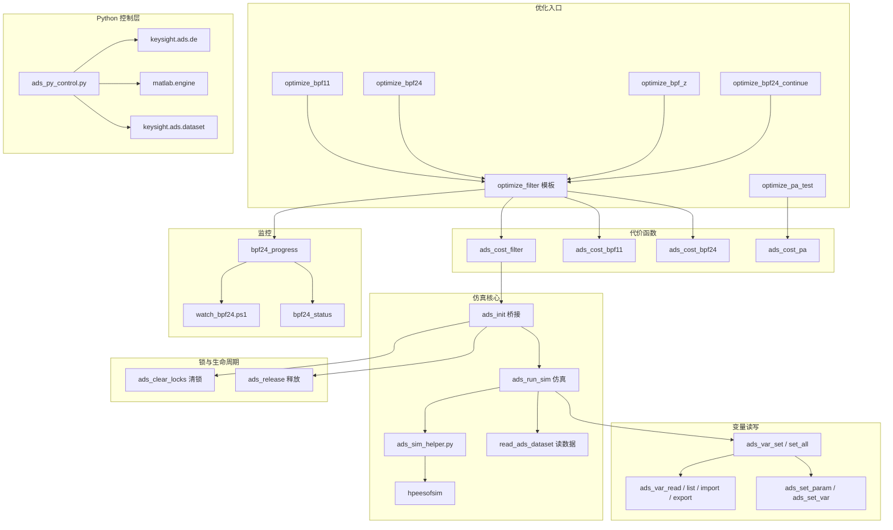

# ADS 自动化相关文件全景总览

> 整理日期：2026-09-08
> 适用环境：ADS 2025 Update2 + MATLAB R2025a + ADS 自带 Python 3.12
> 关联文章：《用Python玩转Keysight ADS：自动化原理图设计与仿真实战指南》

---

## 一、总览图



---

## 二、按功能模块详细分类

### A. 优化入口脚本（如何触发一次优化）

| 文件 | 说明 | 优化对象 |
|------|------|---------|
| [optimize_filter.m](optimize_filter.m) | **通用优化模板**，改 `cfg.cell` 即可优化任意滤波器 | 通用 |
| [optimize_bpf11.m](optimize_bpf11.m) | 调理 BPF1.1（2.4GHz 带通）| Study_lib:BPF1.1 |
| [optimize_bpf24.m](optimize_bpf24.m) | 调理 BPF1（2.4GHz 带通）| BPF |
| [optimize_bpf24_continue.m](optimize_bpf24_continue.m) | BPF24 二次续跑（提高收敛）| BPF |
| [optimize_bpf_z.m](optimize_bpf_z.m) | 调理 BPF_z（3.5GHz 中心，2GHz 带宽）| Study_lib:BPF_z |
| [optimize_pa_test.m](optimize_pa_test.m) | 功放 HB 优化（非线性）| JHJ_CLASSF_Filter_wrk |

### B. 代价函数（评估目标函数）

| 文件 | 说明 |
|------|------|
| [ads_cost_filter.m](ads_cost_filter.m) | **通用滤波器代价**（S21 通带/阻带 + S11 + 平坦度，max 惩罚）|
| [ads_cost_bpf11.m](ads_cost_bpf11.m) | BPF1.1 专用代价（含缓存+进度条）|
| [ads_cost_bpf24.m](ads_cost_bpf24.m) | BPF1 专用代价（含缓存+进度条）|
| [ads_cost_cell1.m](ads_cost_cell1.m) | cell_1 代价 |
| [ads_cost_pa.m](ads_cost_pa.m) | 功放 HB 代价（Pout/PAE/Gain 等）|
| [ads_lpf_cost.m](ads_lpf_cost.m) | 低通滤波器代价 |

### C. 仿真核心链路

| 文件 | 说明 |
|------|------|
| [ads_init.m](ads_init.m) | **建桥**：MATLAB → ADS Python（`pyenv` OutOfProcess + `HPEESOF_DIR`）|
| [ads_run_sim.m](ads_run_sim.m) | 生成网表 → 调 `ads_sim_helper.run_hpeesofsim` → 读回 `.ds` |
| [ads_sim_helper.py](ads_sim_helper.py) | Python 端：搭建 hpeesofsim 环境、跑子进程、写网表 |
| [read_ads_dataset.m](read_ads_dataset.m) | MATLAB 读 `.ds` 仿真数据集（freq/S 参数）|
| [ads_read_hb_pa.m](ads_read_hb_pa.m) | 读功放 HB 数据集 |

### D. 变量读写与参数设置

| 文件 | 说明 |
|------|------|
| [ads_var_read.m](ads_var_read.m) | 读原理图所有 Var Eqn 变量（自动去 tune/opt 后缀）|
| [ads_var_set.m](ads_var_set.m) | 通用设参（按名自动分组到所属 VAR）|
| [ads_var_set_all.m](ads_var_set_all.m) | 一次性设置所有变量（数值向量或 cell）|
| [ads_var_list.m](ads_var_list.m) | 列出变量 |
| [ads_var_import.m](ads_var_import.m) | 原理图变量导入 MATLAB 工作区 |
| [ads_var_export.m](ads_var_export.m) | MATLAB 变量写回原理图 |
| [ads_set_param.m](ads_set_param.m) | 直接设置实例参数（`find_instance` 方式）|
| [ads_set_var.m](ads_set_var.m) | 设置某个 VAR 的若干变量值 |

### E. 锁管理与生命周期

| 文件 | 说明 |
|------|------|
| [ads_clear_locks.m](ads_clear_locks.m) | 清理残留 `.cdslck` 写锁（读 PID 判断进程是否存活）|
| [ads_release.m](ads_release.m) | 释放工作区锁 + 清理残留 hpeesofsim |

### F. Python 控制层（三层架构：Python↔ADS↔MATLAB）

| 文件 | 说明 |
|------|------|
| [ads_py_control.py](ads_py_control.py) | **Python 中心控制层**：`ADSController`（连 ADS/读变量/仿真/读数据）+ `MATLABHub`（matlab.engine）+ `cost_from_s` |
| [auto_optimize.py](auto_optimize.py) | 纯 Python 全自动优化器（scipy differential_evolution 等）|

### G. 监控与可视化

| 文件 | 说明 |
|------|------|
| [scripts/bpf24_progress.m](scripts/bpf24_progress.m) | 优化进度窗口/无头日志（写 `bpf24_progress.log`）|
| [scripts/bpf24_writeback.m](scripts/bpf24_writeback.m) | 最优参数写回原理图 + 验证 |
| [scripts/bpf24_writeback_fast.m](scripts/bpf24_writeback_fast.m) | 快速写回（新最优实时写，不验证）|
| [scripts/bpf24_should_stop.m](scripts/bpf24_should_stop.m) | 停止请求检查 |
| [bpf24_status.m](bpf24_status.m) | 一键查实时进度（读日志 + 进程状态）|
| [watch_bpf24.ps1](watch_bpf24.ps1) | PowerShell 实时 tail 进度（`Get-Content -Wait`）|
| [.vscode/tasks.json](.vscode/tasks.json) | VS Code 任务 `BPF_z: 查看优化实时进度` |

### H. 结果后处理与检查脚本

| 文件 | 说明 |
|------|------|
| [analyze_bpf_z_result.m](analyze_bpf_z_result.m) | 读最优 .mat，输出通带/阻带精确 S 参数 |
| [write_best_to_schematic.m](write_best_to_schematic.m) | 把最优参数写回原理图并验证 |
| [inspect_bpf_z.m](inspect_bpf_z.m) | 读 BPF_z 元件清单 + 变量 + SP 频段 |
| [inspect_bpf_z_net.m](inspect_bpf_z_net.m) | 读 BPF_z 微带线元件参数 |
| [inspect_stub_param.m](inspect_stub_param.m) | 检查 stub 参数 |
| [inspect_stub2_expr.m](inspect_stub2_expr.m) | 检查 stub2 表达式 |
| [inspect_stub2_ls.m](inspect_stub2_ls.m) | 检查 stub2 线路 |
| [inspect_stub2_ls_raw.m](inspect_stub2_ls_raw.m) | 检查 stub2 原始线路 |

---

## 三、ADS 设计单元（work/Study_wrk/Study_lib）

| 设计单元 | 解码原名 | 用途 |
|---------|---------|------|
| `%B%P%F_z` | BPF_z | **3.5GHz 带通滤波器**（主要优化对象，14 变量）|
| `%B%P%F1` | BPF1 | 2.4GHz 带通 |
| `%B%P%F1#2e1` | BPF1.1 | 2.4GHz 带通 |
| `%B%P%F1#2e2` | BPF1.2 | 带通 |
| `%B%P%F_z1` | BPF_z1 | 带通变体 |
| `%I%N%P%U%T` | INPUT | 输入匹配 |
| `%O%U%T%P%U%T` | OUTPUT | 输出匹配 |
| `cell_1` ~ `cell_5` | cell_1-5 | 通用电路单元 |
| `3#2e4%G%H%Z_%Filter` | 3.2GHz Filter | 3.2GHz 滤波器 |
| `%D%A_%Smith%Chart%Match*` | DA Smith Chart Match | 匹配网络 |

> 说明：ADS 工作区里单元名用 URL 编码存储（`%B%P%F_z` 显示为 BPF_z），实际调用用 `Study_lib:BPF_z:schematic`。

---

## 四、环境配置文件

| 文件 | 说明 |
|------|------|
| [de_sim.cfg](de_sim.cfg) | ADS 设计环境仿真配置 |
| [hpeesofsim.cfg](hpeesofsim.cfg) | hpeesofsim 仿真引擎配置 |

---

## 五、ADS Python API 知识库（学习资料）

位于 `<KNOWLEDGE_BASE>\`：

| 文件 | 说明 |
|------|------|
| [00_文档导航总览.md](ADS仿真知识库/00_文档导航总览.md) | 知识库导航 |
| [01_入门指南.md](ADS仿真知识库/01_入门指南.md) | ADS 入门 |
| [02_设计与技术管理.md](ADS仿真知识库/02_设计与技术管理.md) | 设计与技术管理 |
| [03_电路仿真.md](ADS仿真知识库/03_电路仿真.md) | 电路仿真 |
| [04_EM电磁仿真.md](ADS仿真知识库/04_EM电磁仿真.md) | EM 电磁仿真 |
| [05_Python_API.md](ADS仿真知识库/05_Python_API.md) | **Python API**（de/dataset/dds/ael/ann 模块）|
| [06_验证与制造.md](ADS仿真知识库/06_验证与制造.md) | 验证与制造 |
| [07_Design_Cloud.md](ADS仿真知识库/07_Design_Cloud.md) | Design Cloud |
| [RFPro电磁仿真工具详解.md](ADS仿真知识库/RFPro电磁仿真工具详解.md) | RFPro 工具 |
| [参数化工具/](ADS仿真知识库/参数化工具/) | 参数化工具目录 |
| [射频功放知识/](ADS仿真知识库/射频功放知识/) | 射频功放知识 |

---

## 六、优化结果存档（优化结果/ 目录）

| 文件 | 说明 |
|------|------|
| `Filter_optimize_*.mat` | 滤波器优化结果（x_best/cost_best/var_names）|
| `BPF24_optimize_*.mat` | BPF24 优化结果 |
| `BPF24_continue_*.mat` | BPF24 续跑结果 |
| `bpf24_progress.log` | 当前优化实时进度日志 |
| `*_s_params.png` | S 参数曲线图 |
| `*_param_comparison.png` | 参数对比图 |
| `*_optimize_best_*.png` | 最优波形图 |

---

## 七、scripts/ 子目录其他工具

| 文件 | 说明 |
|------|------|
| [scripts/demo_optimize.m](scripts/demo_optimize.m) | 优化演示 |
| [scripts/demo_optimize_cell1.m](scripts/demo_optimize_cell1.m) | cell_1 优化演示 |
| [scripts/demo_opt_var_auto.m](scripts/demo_opt_var_auto.m) | 自动变量优化演示 |
| [scripts/demo_plot_s21.m](scripts/demo_plot_s21.m) | S21 绘图演示 |
| [scripts/read_bpfz_result.m](scripts/read_bpfz_result.m) | 读 BPF_z 结果 |
| [scripts/check_rfpro_params.py](scripts/check_rfpro_params.py) | RFPro 参数检查 |
| [scripts/layout_optimizer.py](scripts/layout_optimizer.py) | 版图优化 |
| [scripts/layout_opt_loop.py](scripts/layout_opt_loop.py) | 版图优化循环 |
| [scripts/read_em_results.py](scripts/read_em_results.py) | 读 EM 结果 |
| [scripts/read_rfpro_results.py](scripts/read_rfpro_results.py) | 读 RFPro 结果 |
| [scripts/save_opt_to_layout.py](scripts/save_opt_to_layout.py) | 保存优化到版图 |
| [scripts/kill_residual_hpeesofsim.ps1](scripts/kill_residual_hpeesofsim.ps1) | 清理残留仿真进程 |

---

## 八、vscode 配置

| 文件 | 说明 |
|------|------|
| [.vscode/tasks.json](.vscode/tasks.json) | VS Code 任务 `BPF_z: 查看优化实时进度` |

---

## 九、启动命令速查

```powershell
# 1. 运行 BPF_z 优化
matlab -sd "<MATLAB_ADS>" -batch "optimize_bpf_z"

# 2. 实时查看进度（推荐）
powershell -NoProfile -ExecutionPolicy Bypass -File "<MATLAB_ADS>\watch_bpf24.ps1"

# 3. MATLAB 查询进度
matlab -sd "<MATLAB_ADS>" -batch "bpf24_status"

# 4. Python 控制层读变量（只读）
$env:HPEESOF_DIR = "D:\Program Files\Keysight\ADS2025_Update2"
& "D:\Program Files\Keysight\ADS2025_Update2\tools\python\python.exe" <MATLAB_ADS>\ads_py_control.py --mode readvars
```

---

## 十、关键经验与注意事项

1. **ADS 锁机制**：`DesignMode` 只有 `APPEND/READ_ONLY/WRITE`，无共享写模式。GUI 打开原理图(独占写锁)时，Python/MATLAB 只能 `READ_ONLY` 读。
2. **优化实时写回**：`ads_cost_filter` 每次找到新最优，`bpf24_writeback_fast` 立即写原理图并保存，用户在 ADS 刷新即可看到。
3. **仿真速度**：单次仿真平均 ~10s（401 点，SP 步进 0.01GHz）。加速可用：SP 步进改 0.02GHz、边界缩到 ±40%、代数减半。
4. **MATLAB Engine**：ADS Python 需 `pip install "matlabengine==25.1.*"`（R2025a 对应版本）。
5. **编码**：`.ps1` 脚本须 UTF-8 BOM 编码，日志读取用 `-Encoding UTF8`。
