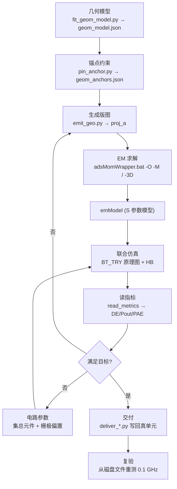

# AI 可读 · 原理图/版图联合仿真优化全流程

> 目标：让 AI 读完这一份就能改这个工程并复现结果。只写"做什么、用什么、产出什么、会怎么错"。
> 面向人读的版本见 [../INDEX.md](../INDEX.md) 与 [工作总结-2026-09-11至14.md](工作总结-2026-09-11至14.md)。

---

## 0. 常量（唯一事实来源，不要硬编码到别处）

```yaml
ADS_ROOT:    D:\Program Files\Keysight\ADS2025_Update2
ADS_PY:      D:\Program Files\Keysight\ADS2025_Update2\tools\python\python.exe   # 3.12
ADS_SIM:     D:\Program Files\Keysight\ADS2025_Update2\bin\hpeesofsim.exe
MOMENTUM:    D:\Program Files\Keysight\ADS2025_Update2\bin\adsMomWrapper.bat
MATLAB:      <MATLAB_HOME>\bin\matlab.exe
TOOLS:       <MATLAB_ADS>

# 本功放工程
WRK:         <MATLAB_ADS>\work\JHJ_CLASSF_Filter_wrk
LIB:         JHJ_CLASSF_Filter_lib
CELL_LAYOUT: BT20_geo_opt      # 视图 layout / emSetup / emModel
CELL_BENCH:  BT_TRY            # 视图 schematic，测试台，内含 EM 器件实例

# 器件与工艺（硬约束，不可换：基板贵）
DEVICE:      CGH40010F   Vdd=28V  R_opt≈16.5Ω
SUBSTRATE:   RO4350B  er=3.66  h=0.762mm  tanδ=0.0037  Cu=35µm
BAND:        3.00-4.00 GHz @ 0.1 GHz 步长 = 21 点
PIN:         30 dBm   # 固定，不可改
TARGET:      DE ≥ 60% 每个频点
```

**目录名转义**：ADS 把单元名里**每个大写字母**转义为 `%X`。
`BT_TRY` → `%B%T_%T%R%Y`，`BT20_geo_opt` → `%B%T20_geo_opt`。
**但 `simulation\` 目录树下不转义**。搞错会导致"复制成功但没生效"。

---

## 1. 流程总览



两条可独立也可联动的搜索轴：**版图几何**（走 EM）与**电路参数**（走原理图，无需重跑 EM）。
EM 昂贵（一次求解分钟级），电路参数便宜（一次评估十几秒）——**先用便宜的砍掉大部分空间**。

---

## 2. 阶段详解

每阶段给出：入口 → 产出 → 失败模式。

### S1 几何模型
- 入口 `fit_geom_model.py`：扫版图实例，拟合出可优化的几何变量。
- 产出 `geom_model.json`（`variables` 字典）。
- 失败：版图实例带算术表达式（如 `(A-B)*0.5`），无法反解 → 跳过并报告，不要强行写。

### S2 锚点约束（**不做这步 EM 会直接拒算**）
- 入口 `pin_anchor.py` → `geom_anchors.json`。
- 规则：**带 pin 的矩形，其 pin 所在轴的最小/最大边锁死，另一轴锁中心**。否则移动后 pin 离开金属，Momentum 报 `This setup is invalid`。

### S3 生成版图
- 入口 `emit_geo.py`，`--set NAME=VALUE` 改变量。
- 必含 `heal()`：几何变动会把原本搭接的金属扯开，自动把移动边延长、或平移无 pin 的碎片，补回重叠。
- **自检**：往返一致（读回 `emit_geo` 产物应还原输入变量）。改完必须重跑 `verify_gen_proj_a.py`。

### S4 EM 求解
- 入口 `run_em_cli.py`（命令行）或 `sample_geo.py` 内部调用。
- 步骤：`-O -M` 建网格 → `-3D` 求解。
- **三条硬规则**：
  1. `-3D` **复用已有结果**，不删就永远拿到旧数据 → 跑前删 `proj.sio` 和 `proj.log`。
  2. 改 EM 频段前必须 `-O -DB`，否则基板 DB 不一致。
  3. **两个 EM 扫描不能并行**（共享基板 DB `SPB_Data\substrates\0000.sdb`）。
- EM 频段**不可收窄**：`MaxOrder=4` 意味着器件需要 4×f0（≈16 GHz）的终端，收窄会得到错误答案（实测 59.38% vs 正确 70.88%）。

### S5 联合仿真
- `BT_TRY` 原理图里把 `emModel` 当器件实例化；评估时把 `modelFile=` 指向目标 `emModel/model.ndx`。
- 这是**唯一把版图与电路接起来的地方**。

### S6 读指标（数据契约）
```python
from pa_metrics_de import read_metrics
m = read_metrics(ds_path)
# 键: freq, de, pae, pout_w, pout_dbm, gain_db, ls_gain_db, pdc, pin_w
# DE = Pout/Pdc  —— 所以要报 DE 增益，必须同时看 Pout 有没有塌
```
- 频率取 HB varblock 的 `freq` 列（绝对 Hz），**不要**用 `RFfreq` 索引值（它是 MHz）。

### S7 搜索
| 轴 | 脚本 | 关键参数 |
|---|---|---|
| 版图几何 | `sample_geo.py` | `--set/--step/--sigma-rel/--maxfix/--em-step/--warm/--workers` |
| 电路参数 | `lumped_search.py` | `--pin/--goal {worst,window,deficit}/--warm/--budget` |
| 单元件扫描 | `lumped_sweep.py` | `--part/--res/--vgs/--values` |
| 验证 | `lumped_verify.py` | `--recipe FILE --pins 30,32,33` |

目标函数选择（**选错会白跑一整轮**）：
- `worst` = 抬高全带最差点 → 能填坑，但会砍掉带宽（实测窗口从 0.85 塌到 0.50 GHz）。
- `window` = 最宽连续达标窗口 → 匹配"报一段带宽"。
- `deficit` = 总缺口最小、**即"全部达标"的条件**（deficit==0 等价于 21/21）→ 固定单点 Pin 时用这个。

### S8 交付
- 几何：`deliver_geo.py`（克隆版图 + 写实例参数 + 文件级复制 emSetup/emModel + 删旧结果 + 重跑 EM + 装 `data.000.sio` + 复验）。
- 电路参数：`deliver_lumped.py`（写原理图实例参数 + 从保存的文件复测）。

### S9 复验（**交付的最后一步，不可省**）
必须**从磁盘上的交付单元自己重测**，而不是复用搜索时的内存结果。跨网表会得到不同答案。

---

## 3. MATLAB 侧（原理图参数优化）

MATLAB 不参与 EM，它驱动的是**原理图级**优化（匹配网络、偏置、微带线长度）。

```matlab
cd('<MATLAB_ADS>');            % 否则找不到函数
[de, ds] = ads_init();             % 建桥：pyenv OutOfProcess + HPEESOF_DIR
ws = de.open_workspace(WRK);
d  = ws.design('LIB:CELL:schematic', de.db.DesignMode.APPEND);

ads_var_list(d);                   % 枚举所有 VAR 及变量名
T = ads_var_read(d);               % 读当前值
ads_var_set(d, {'L1',9.07; 'W3',1.61});   % 按变量名设参（自动分组到所属 VAR）
out = ads_run_sim(d, WRK, 'INPUT');       % 生成网表 → hpeesofsim → 读回
s11 = 20*log10(abs(out.data.S.S_1_1(i0)));% 纯 MATLAB 后处理
de.close_workspace();              % 释放写锁
```

自动优化闭环：
`pa20_ctx.m`（建上下文）→ `pa20_eval.m` / `pa20_batch.m`（评估/并行）
→ `pa20_algos.m`（`rand/nm/ps/ga/pso/sa/so/hyb`）→ `optimize_pa20.m` → `validate_final.m`（独立复验）。

常用命令：
```powershell
& $MAT -batch "cd('<MATLAB_ADS>'); optimize_pa20(struct('cell','PA20_opt2_final','window',1,'budget',500))"
```

**两个桥接坑**：
1. 必须 `ExecutionMode='OutOfProcess'`，否则 `Failed to load the _pde extension module`。
2. `.m` 里不要写 `obj.__xxx__`（报"文本字符无效"）；取列用 `df.get('S[2,1]')`，转字符用 `char(obj)`。

---

## 4. 不变量（Invariants）

违反其中任何一条，结果都不可信：

1. **评估不收敛 = 失败。** 不许把算不出的点剔除后宣称达标。
   （本工程曾因此产生假结果：3 个点让直流求解器发散 → DE/Pout 全 NaN → 旧评分把 NaN 从窗口和缺口里过滤掉 → 缺口从 26 点"降到"0.95 点。实际那 3 点正是带内最差点。）
2. **Pin 固定 30 dBm。** 饱和区（如 33 dBm）达标不代表标称点达标。
3. **基板不可换，EM 频段不可收窄。**
4. **复验步长 0.1 GHz。** 0.5 GHz 步长会把最差 DE 高估最多 3.7 点（同一几何：0.5→56.689%、0.1→52.946%）。**对比与交付必须同一步长。**
5. **`PartNumber` 是按元件系列索引的。** 混用系列会取到不存在的零件。
   （实测：C7 是 GCM55/2220，表只到 16；其余是 GCM15/0402，表到 130。给 C7 填 46 会被 API 存成 `NULL`，而 NULL 让仿真完全不出数据。）
6. **给 DE 增益必须同时验 Pout。** DE=Pout/Pdc，Pout 塌了也能"效率变高"。
   评分闸门（`sample_geo.py`）：`0 ≤ DE ≤ 100`、`Pout > 0.01 W`、
   `POUT_FLOOR_DBM = 33`（Pin=30 → 等价于"增益 ≥ 3 dB"的守卫）。
7. **复现性判据用绝对偏差**，不用相对误差 —— 在 `|S| ≈ 0` 处相对误差会虚假放大。
8. **交付前必须在交付单元自己的网表上端到端复算**。跨网表会得到不同答案。
9. 中心频率 **3.5 GHz**，带宽按"以中心定带宽"理解。

---

## 5. 高频陷阱速查

| 现象 | 真因 | 处置 |
|---|---|---|
| 交付后测量无数据集 | `.ds` 按**网表顶层设计名**命名（`BT_TRY.ds`），不是 `design_name` | 跑前删旧 `.ds`，跑后取 `sim_dir` 里最新的 |
| 拿到了上一次的结果 | 同上，失败时旧文件被当新结果 | 必须先删再跑 |
| `WRITE` 模式打开设计得到 0 个实例 | `WRITE` 语义是"新建/覆盖" | 用 `DesignMode.APPEND`；`READ_ONLY` 一碰实例属性就崩 |
| 写参数后仿真不变量 | 值丢了单位/元数据（如 `10 Ohm notune{...}`） | 保留后缀；若新值越出 tune 区间，丢弃该区间（别留自相矛盾） |
| 回读报告"未确认"但实际已写入 | 参考标号 ≠ 网表实例名（`VGS` 的实例是 `SRC4`） | 回读按**实例名**匹配 |
| 第 N 次搜索发现上次最优没了 | 沙箱目录被 `rmtree`，结果文件也在里面 | 结果目录不要做成沙箱的父目录 |
| 退出码 1 但结果正常 | ADS 的 `vtb.defs` 警告写到 stderr | 看产物，不看退出码 |
| 优化器"越优化越好"但物理上没改善 | 目标函数把缺失点当免费 | 缺失点至少按"完全失败"计费 |

---

## 6. 端到端最小复现

```powershell
$ADS = 'D:\Program Files\Keysight\ADS2025_Update2\tools\python\python.exe'
cd <MATLAB_ADS>

# 自检（改完搜索/补丁逻辑必跑）
& $ADS test_lumped_patch.py                    # 期望 all checks passed

# 逐点诊断（有频点算不出来时用这个点名）
& $ADS dump_curve.py --recipe '_geosearch\lumped\pin30_v2_final.json' --pin 30

# 一次搜索
& $ADS lumped_search.py --pin 30 --goal deficit --budget 160

# 验证 + 交付 + 从文件复验
& $ADS lumped_verify.py  --recipe '_geosearch/<recipe>.json' --pins 30
& $ADS deliver_lumped.py --recipe '_geosearch/<recipe>.json' --pins 30 --apply
```

验收判据（全部满足才算通过）：
- 21 个频点**全部有 DE**（无 NaN 警告）
- 从**保存后的文件**重测的数字 == 搜索报告的数字
- 网表回读 N/N 确认
- Pout 未塌（偏差 < 0.3 dB）
- 每个改动过的元件值都在其合法范围内

---

## 7. 当前状态（2026-09-16）

| 配置 | Pin | 最差 | 均值 | 达标 | ≥60% 窗口 |
|---|---|---|---|---|---|
| 出厂 | 30 | 55.436 | 60.152 | 11/21 | 0.20 GHz |
| 配方 D（已交付） | 30 | 57.430 | 63.242 | 18/21 | 0.60 GHz |
| 配方 C | 33 | 60.640 | 65.947 | 21/21 | 1.00 GHz |

配方 D（Pin 30 约束下的最优，缺口 26.34→5.49 点，仅剩 3.25/3.30/3.35 GHz 三点各差 1.4-2.6 点）：

```
R4=68  R5=22  C25=54  C41=50  C48=100
C49=130 C52=30 C6=38  C7=4   C24=46   VGS=-3.3
```

**Pin 30 下"全部达标"尚未达成。** 剩余缺口 5.49 点。
下一个方向：VGS 连续值细搜（现只在 11 个离散点上搜）+ 针对 3.25-3.35 GHz 的定向调整。

明细见 [../_geosearch/recipes.md](../_geosearch/recipes.md)。
