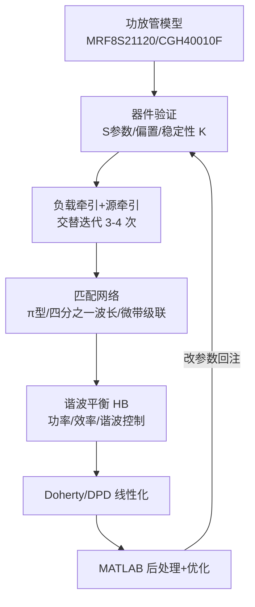

# 射频功放 · ADS-MATLAB 联合仿真 学习笔记

> 日期：2026-08-15　|　来源：CSDN 系列文章 + 期刊文献 + 知乎/文库（子代理系统抓取）
> 目的：为「MATLAB ↔ keysight.ads → 仿真 → 读回 → 优化」闭环补充射频功放领域的做法与经验。

---

## 1. 文章清单与可读性

| 文章 | 作者 | 正文状态 | 主题（确认/推断） |
|---|---|---|---|
| 射频功放学习之ADS-MATLAB联合仿真（一） | 长风弦歌 | 付费 | 联合仿真流程总述；关联 **Ptolemy 混合仿真器** |
| （二） | 长风弦歌 | 付费+反爬 | 正文不可读 |
| （三） | 长风弦歌 | 付费+反爬 | **ADS↔MATLAB 阻抗匹配网络寻优**（URL 标签） |
| （四） | 长风弦歌 | 付费+反爬 | **S 参数导入 MATLAB**；`ADSrunSimulation` 函数 + MATLAB 路径配置 |
| 射频功放学习中的ADS-MATLAB联合仿真 | DsdActionscript | 反爬 | 分步骤教程：建立器件模型→定义 MATLAB 仿真函数 |
| 射频功放学习：ADS-MATLAB联合仿真 | CyberSparkZ | 反爬 | 知识点式：建立 ADS 连接、指定工程文件 |
| 用Matlab自动处理ADS仿真数据，优化双输入Doherty功放 | weixin_27697385 | 反爬 | **双输入 Doherty 数据处理自动化**（2026，与你的项目最接近） |

> 7 篇正文大多被付费墙 + Cloudflare 521 拦截，信息来自摘要/URL 语义/关联推荐，个别细节无法确认。

**延伸好文**（正文可读）：知乎《功放芯片设计之如何进行ADS仿真设置》、CSDN 文库《宽带非对称连续J/F-1模式Doherty功放ADS仿真复现》、期刊《基于MATLAB和ADS的数字预失真系统仿真》等。

---

## 2. 六种联合仿真/数据交互方式

| 方式 | 说明 |
|---|---|
| ① ADSrunSimulation `.m` 接口 | 2022 年前主流：MATLAB 调 ADS 官方 .m 函数启仿真、读写数据集（需把 .m 放 bin + 加路径 + 重启） |
| ② TADSInterface 类 | 未公开接口：设环境/改 Var Eqn/元件参数/跑仿真/dsdump 读结果（只测到 ADS 2022） |
| ③ 数据文件交换 | ADS 导 `.s2p` → MATLAB `sparameters`/RF Toolbox 导入 |
| ④ ADS Ptolemy ↔ MATLAB | 系统级：Ptolemy 提基带 IQ → MATLAB 建 DPD 模型（ACPR 改善 20dB+） |
| ⑤ MATLAB 算 → ADS 验证 | 单向：MATLAB 先算匹配网络/波形/相位特性，ADS 电路验证 |
| ⑥ ADS 脚本反向控 MATLAB | 较少见 |

---

## 3. 射频功放典型设计流程

**MATLAB 在各环节的角色**：
1. **前计算**：EF2/J/F-1 类参数、匹配网络元件值、理想相位 → ADS 验证
2. **设参+驱动**：改 Var Eqn/元件参数、跑仿真（= 你已打通的闭环）
3. **结果提取**：读 dataset/S 参数；⚠️ 要先在 ADS 里**编辑 Equations** 才能读到 Pout/PAE/ACPR/XdB 压缩点
4. **负载牵引/扫描后处理**：Doherty 多频点、负载牵引数据交给 MATLAB 自动处理寻优
5. **优化器**：阻抗匹配寻优、SPSA、双输入 Doherty 优化
6. **线性化**：Ptolemy 提基带 IQ → MATLAB GMP 建模 → DPD

---

## 4. 可直接借鉴到「我的 MATLAB↔keysight.ads 闭环」的要点

1. **设参范式**：改 Var Eqn / 元件参数 → 仿真 → 读回（正是 TADSInterface/ADSrunSimulation 的原始做法，但你的官方 API 更稳、且能保存到原理图）。
2. **PA 指标目标**：优化代价建议用 **输出功率 Pout / PAE / ACPR / XdB 压缩点**（不只 S 参数）；前提是 ADS 原理图已建好对应 Equations。
3. **牵引经验约束**（可直接写进代价/约束）：
   - 负载/源牵引需**交替迭代 3–4 次**收敛，过度优化会引入不稳定；
   - **三次以上谐波控制对效率改善有限，反而影响线性度**。
4. **Doherty 双输入**：多频点扫描数据 → MATLAB 自动提取效率包络 → 反推最优输入配置（文章7 范式）。
5. **DPD（若做）**：ADS Ptolemy 提基带 IQ → MATLAB GMP 建模 → ACPR +20dB。
6. **S 参数导入**：可用 RF Toolbox `sparameters` 读 `.s2p`；HB 功率/效率用 `read_ads_dataset` 解析。

---

## 5. 注意事项 / 坑

- **版本**：ADSrunSimulation/TADSInterface 用**未公开接口**，只测到 ADS 2022，新版可能失效 → 不要依赖，你的官方 keysight.ads API 是更优解。
- **环境配置**：`HPEESOF_DIR`、`SIMARCH`、`adsptolemy\lib.<SIMARCH>` 必须正确（你已在 `ads_sim_helper.py` 处理）。
- **网表 vs 原理图**：TADSInterface 只改网表、ADS IDE 重启仿真就丢；你的 APPEND+save_design 能真正落盘。
- **模型可得性**：拿不到管芯模型只能按 S 参数设计，会限制 HB/负载牵引精度。
